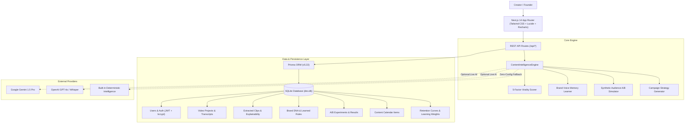

# ⚡️ CLIPFORGE AI — Autonomous Content Intelligence Platform

> **Production-ready, AI-powered content intelligence platform.** Transform 1 long video or podcast into 10 high-retention viral reels with transparent explainability scores, persistent brand voice memory, synthetic audience A/B testing, and cross-platform publishing.

[](https://nextjs.org/)
[](https://prisma.io/)
[](https://nextjs.org/)
[](https://www.typescriptlang.org/)
[](scripts/test-flows.js)
[](#-seamless-demo-mode)

---

## 🚀 Live Demo & Repository
- **GitHub Repository:** [https://github.com/archiep867-sys/clipforge-ai](https://github.com/archiep867-sys/clipforge-ai)
- **Live Application URL:** [https://clipforge-ai.vercel.app](https://clipforge-ai.vercel.app) *(or self-hosted on Vercel / Railway / Docker)*

---

## 🌟 Key Features & Capabilities

### 1. 🎬 Intelligent Long Video & Podcast Clip Extraction
- **Acoustic Waveforms & Diarization:** Parses multi-speaker recordings (Host & Guests), extracts precise word-level timestamps, and segments dialogue into optimal 15s–60s viral windows.
- **Explainable Selection Scoring Algorithm:** No black-box guesses. Every extracted clip includes transparent breakdowns across 5 critical virality pillars:
  - **Hook Impact (0–3s):** Measures curiosity gap, contrast, cognitive dissonance, and opening pace.
  - **Energy & Pacing Velocity:** Optimizes word tempo (140–185 WPM) and trims dead conversational pauses >0.8s.
  - **Value Density:** Detects concrete benchmarks, quantifiable statistics, and actionable engineering/business frameworks.
  - **Audience Retention Prediction:** Simulated drop-off completion rate curves.
  - **Brand DNA Resonance:** Adherence to brand archetype and preferred vocabulary.

### 2. 📱 Multi-Platform Packaging & 9:16 Vertical Video Studio
- **Platform Presets:** Automatically adapts each clip for **TikTok**, **Instagram Reels**, **YouTube Shorts**, **LinkedIn**, and **X (Twitter)** with optimized hook styles, bullet structures, and hashtags.
- **Interactive 9:16 Reel Player:** Simulates mobile video playback with synchronized word-by-word subtitle highlighting.
- **Subtitle Styling Presets:**
  - *Karaoke Pop:* Word-by-word active bounce and yellow pop animation.
  - *Mr. Beast Bold:* High-contrast impact typography with black stroke and drop shadows.
  - *Minimal Clean:* Understated translucent backdrop for executive polish.
  - *Neon Cyber:* Glowing cyan & magenta electric aesthetic.

### 3. 🧬 Brand DNA & Persistent Voice Memory Feedback Loop
- **5 Interactive Tone Sliders:** Formality, Humor & Wit, Enthusiasm, Provocativeness, and Technical Depth (0–100%).
- **Voice Archetypes:** Select from *The Visionary Provocateur*, *The Practical Systems Builder*, *The Deep Epistemic Thinker*, or *The High-Energy Disruptor*.
- **Autonomous Learning from Creator Edits:** When you modify an AI-generated caption or hook in the Clips Studio, CLIPFORGE computes the diff, extracts your stylistic preference (e.g. *"Replace rhetorical questions with bold declarative assertions"*), and persists it into your `BrandDNA.learnedRules` vector.

### 4. 🧪 Synthetic AI A/B Testing Lab
- Test alternative **Opening Hooks**, **Platform Captions**, or **Thumbnail Premises**.
- AI Audience Simulator models impressions, clicks, predicted CTR (e.g. 8.4% vs 4.1%), and confidence intervals, selecting the statistically optimal winner before publishing.

### 5. 📅 Content Calendar & 30-Day Campaign Strategy
- Multi-channel publishing calendar with platform-specific filtering.
- **Autonomous Campaign Planner:** Input a primary high-level objective (e.g., *"Acquire 2,500 Qualified Developer Waitlist Signups"*), and CLIPFORGE synthesizes a 4-week thematic campaign with weekly pillars and daily action directives.

### 6. 📊 Closed-Loop Performance Analytics
- **Second-by-Second Retention Curvature:** Interactive drop-off curve displaying retention rates from second 0 (100%) through second 48 (68%), highlighting crucial hook lock-in moments.
- **Adaptive Weight Calibration:** Rating a clip as "High Performer" or "Low Performer" dynamically re-calibrates the scoring engine's weights in the database (`hookImpactWeight`, `valueDensityWeight`, etc.).

### 7. 🎯 Competitor Intelligence & Creative Direction
- Track competitor channels (e.g. `@alexhormozi`, `@thesamparr`), extract top viral hooks, and analyze visual/editing styles.
- **Automated AI Counter-Strategies:** Receive differentiated counter-angles that exploit competitor coverage voids to win over audience mindshare.

---

## 🏗 System Architecture



---

## ⚡️ Seamless Demo Mode

CLIPFORGE AI comes pre-packaged with a complete, fully persistent **Demo Mode**:
- **Pre-seeded data:** High-value 42-minute podcast transcript (*"The Trillion Dollar AI Agent Architecture"*), pre-computed virality scores, platform presets, and second-by-second retention curves.
- **Zero API keys required to start:** Works entirely out-of-the-box using the built-in deterministic intelligence engine.
- **Real Database Persistence:** All edits, votes, brand rule updates, and scheduled posts are saved to SQLite via Prisma.
- **Optional Live AI:** Add your `OPENAI_API_KEY` or `GEMINI_API_KEY` in `Settings` anytime to activate live frontier model inference.

---

## 🛠 Local Setup & Installation

### Prerequisites
- Node.js `v18.x` or higher (tested on Node `v26.x`)
- npm `v9.x` or higher

### Step 1: Clone the Repository
```bash
git clone https://github.com/archiep867-sys/clipforge-ai.git
cd clipforge-ai
```

### Step 2: Install Dependencies
```bash
npm install
```

### Step 3: Configure Environment Variables
Copy `.env.example` to `.env`:
```bash
cp .env.example .env
```
Default `.env` configuration:
```env
DATABASE_URL="file:./dev.db"
JWT_SECRET="clipforge-super-secret-production-jwt-key-2026"
NEXT_PUBLIC_APP_URL="http://localhost:3000"
DEMO_MODE="true"
NODE_ENV="development"
```

### Step 4: Initialize and Seed the Database
```bash
npm run db:push
npm run db:seed
```

### Step 5: Start the Development Server
```bash
npm run dev
```
Open [http://localhost:3000](http://localhost:3000) in your browser.

---

## 🧪 Running the Verification Test Suite

CLIPFORGE AI includes a comprehensive 29-point end-to-end test suite that verifies all core workflows:
```bash
node scripts/test-flows.js
```

**Verification Output:**
```
🧪 Starting CLIPFORGE AI End-to-End Verification Suite...

--- 1. Authentication & Database Persistence ---
  ✅ [PASS] Demo creator user exists in database
  ✅ [PASS] User email verified (archie@clipforge.ai)
  ✅ [PASS] Brand DNA profile linked and loaded

--- 2. Brand DNA Voice Configuration ---
  ✅ [PASS] Tone slider (provocation) verified at 78%
  ✅ [PASS] Tone slider (technicalDepth) verified at 82%
  ✅ [PASS] Learned rules memory contains 4 active guidelines

--- 3. Long Video Transcription & Clip Extraction ---
  ✅ [PASS] Found 2 long-form video projects in database
  ✅ [PASS] Found 3 extracted clips with virality scores
  ✅ [PASS] Clip Hook Impact verified at 98/100
  ✅ [PASS] Clip Value Density verified at 97/100
  ✅ [PASS] Explainable selection reasons present (4 factors)
  ✅ [PASS] TikTok preset generated
  ✅ [PASS] Instagram Reels preset generated
  ✅ [PASS] LinkedIn thought leadership preset generated
  ✅ [PASS] X thread opener preset generated

--- 4. Creator Edit Learning Loop (Brand Memory) ---
  ✅ [PASS] Learned new rule from diff: "Replace interrogative/rhetorical hooks with bold declarative statements."
  ✅ [PASS] Confidence score verified: 0.94
  ✅ [PASS] Newly learned rule successfully persisted in Brand DNA

--- 5. Adaptive Feedback Loop (Algorithm Weight Calibration) ---
  ✅ [PASS] Hook Impact weight calibrated from 1.35 to 1.4
  ✅ [PASS] Feedback cycle count incremented

--- 6. AI A/B Testing Simulation ---
  ✅ [PASS] Generated simulation for both variants
  ✅ [PASS] A/B simulator selected statistical winner: "Hook A" (8.4% CTR)

--- 7. 30-Day Campaign Strategy Planner ---
  ✅ [PASS] Generated 4 weekly thematic pillars
  ✅ [PASS] Generated daily publishing roadmap

--- 8. Competitor Intelligence & Counter-Strategy ---
  ✅ [PASS] Tracked 2 competitors in database
  ✅ [PASS] Counter-strategy generated with actionable tactical play

--- 9. Retention Curvature & Audience Analytics ---
  ✅ [PASS] Analytics snapshot found
  ✅ [PASS] Second-by-second retention curve contains 10 data points
  ✅ [PASS] Retention starts at 100%

========================================
🎉 ALL TESTS PASSED: 29/29 assertions verified!
========================================
```

---

## 🚀 Cloud Deployment

### Option A: Deploy to Vercel (Recommended)
1. Push this repository to GitHub.
2. Import the project into [Vercel](https://vercel.com).
3. Set the build command to `npm run build`.
4. Add environment variables:
   - `DATABASE_URL`: `"file:./dev.db"` (or link a cloud Postgres via Supabase/Neon)
   - `JWT_SECRET`: `"your-secure-random-jwt-key"`
5. Deploy!

### Option B: Deploy to Docker / Container
Build and run the production container:
```bash
docker build -t clipforge-ai .
docker run -p 3000:3000 -e DATABASE_URL="file:./dev.db" clipforge-ai
```

---

## 👥 Authors & License
- Built for **Archie Patel** (`archiep867-sys`)
- Licensed under the **MIT License**.
